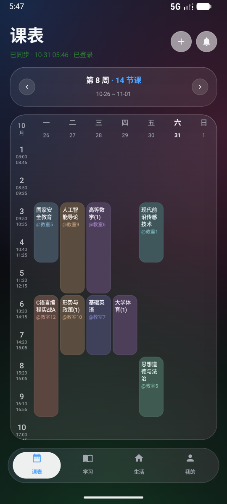
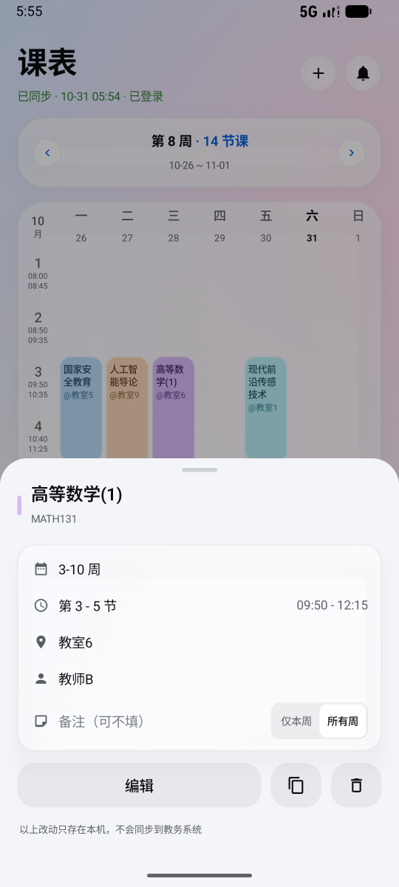
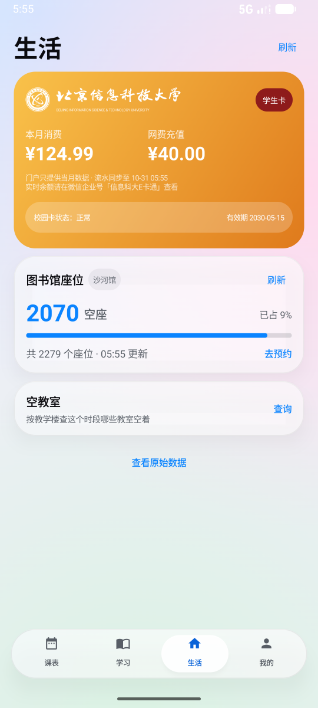
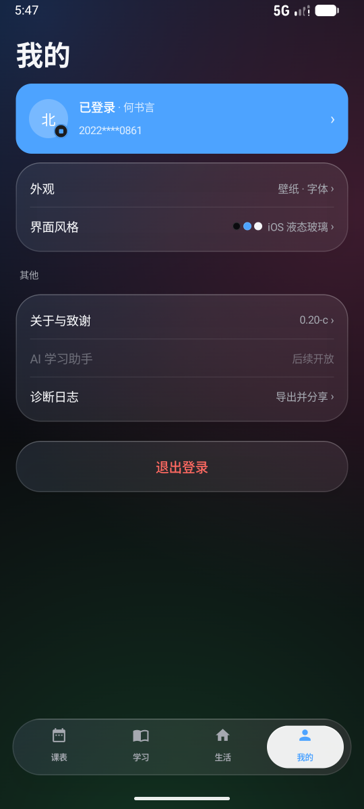

# All the BISTU

北京信息科技大学校园 App，用 Kotlin + Jetpack Compose 写的。把平时要开四五个网页才能办完的事收进一个 App：看课表、查学业、一卡通、空教室、图书馆座位。

未来将会加上电子课本，AI水课辅助，AI学习计划等一系列AI功能以及嵌入U净（如果可以的话，毕竟广告太烦人了），敬请期待。

> 非官方项目，与学校无关。通过学校公开的登录流程读取**本人账号**的数据，不提供任何绕过认证的能力。

## 功能

| 模块 | 说明 |
|---|---|
| **课表** | 周视图网格（节次 / 上课下课时间 / 教室 / 教师），左右滑动切周，支持非本周课程、单双周、连堂课合并 |
| **课程详情** | 点课程弹出详情：备注、仅本周 / 所有周、编辑（换星期/节次）、复制到别的时段、删除、恢复原样 |
| **自定义日程** | 课表右上角「+」新建：名称、开始/结束（日期 + 时间）、重复（永不/每天/每周/工作日）、标签、备注；存本机，按天展开进「学习 → 今日日程」时间线，点条目可改可删 |
| **本地改动层** | 所有手动改动只存**差异**（`CoursePatch`），不动服务器数据；下次同步后用「认课键」重新贴回去 |
| **学习** | 今日日程、学期概览、学业完成查询（学分 / 绩点 / 已修课程） |
| **生活** | 一卡通（本月消费、网费充值、当月流水）、图书馆空座、按教学楼 + 节次查空教室 |
| **提醒** | 课前提醒（AlarmManager 精确闹钟 + WorkManager 每日兜底）覆盖课程和自定义日程，按同一提前量响；另可把整学期课表写进系统日历 |
| **外观** | 六套 UI 风格（原版 / 澎湃 / 线性 / 极简 / Material 3 / iOS 液态玻璃）、深浅主题、配色、字体档位、全局壁纸（蒙层强度可调） |

## 界面

> 截图用的是内置测试账号（昵称「雪霁」），课程、学号、一卡通数字全部本地随机生成，与真人无关。默认风格为 iOS 液态玻璃（浅色）。

| 课表 | 课程详情 |
| :---: | :---: |
|  |  |
| 周视图：节次 + 上下课时间、单双周、连堂课合并 | 点课程弹出详情，备注 / 编辑 / 复制 / 删除都只改本地 |

| 生活 | 我的 |
| :---: | :---: |
|  |  |
| 一卡通当月消费与流水、图书馆空座、空教室查询 | 六套界面风格、配色、字体、壁纸，全部即时生效 |

## 技术栈

- Kotlin 2.2.10 + Jetpack Compose（BOM 2026.02.01）、Material 3
- Android Gradle Plugin 9.4 / Gradle Wrapper、`minSdk 33`（Android 13）、`targetSdk 37`
- 网络：OkHttp，复用 SSO 的 CookieJar；登录用 SM2 国密加密（腾讯 Kona）
- 本地存储：Room（课表缓存）、DataStore（设置）、`filesDir` 下的 JSON（课程改动快照）
- 后台：WorkManager

## 安装

到 [Releases](https://github.com/Azurite258/All_the_BISTU/releases) 下载最新的 `All-the-BISTU-vX.XX.apk` 直接安装。

- 需要 **Android 13 及以上**
- Release 包用 Android Debug 证书签名（自用分发，不上架任何商店），因此可以覆盖安装历史版本

## 构建

```bash
# 需要 JDK 17+ 和 Android SDK（compileSdk 37）
export JAVA_HOME=/path/to/jdk
./gradlew assembleDebug        # 调试包
./gradlew testDebugUnitTest    # 单元测试（270 例）
./gradlew assembleRelease      # 未签名 release 包
```

`app/build.gradle.kts` 里没有配 `signingConfig`，release 包需要自己对齐 + 签名：

```bash
zipalign -p -f 4 app-release-unsigned.apk app-release.apk
apksigner sign --ks ~/.android/debug.keystore --ks-pass pass:android \
               --key-pass pass:android --ks-key-alias androiddebugkey app-release.apk
```

## 目录结构

```
app/src/main/java/com/bistu/allthebistu/
├── data/          网络与数据层：CAS/SM2 登录、教务课表、一卡通（信息门户）、空教室、学业报告
│   ├── patch/     课程本地改动层（差异 + 快照 + 纯函数逻辑）
│   └── prefs/     DataStore 设置：风格、主题、配色、字体、壁纸
├── ui/            Compose 界面：课表 / 学习 / 生活 / 我的 + 六套风格令牌
└── MainActivity.kt
app/src/test/      纯 JVM 单元测试（解析、改动层、课表排布等）
```

## 已知限制

- **一卡通没有实时余额**：信息门户只提供当月数据，且这张流水表里没有微信转账充值和开水机水控，所以 App 只展示本月消费、网费充值和逐笔「交易后余额」。实时余额请到微信企业号「信息科大 E 卡通」查看。
- **横屏未适配**，竖屏是唯一认真调过的方向。
- 学校接口没有公开文档，全部靠抓包与页面反推，随时可能失效。

## 测试账号

App 里带一个**完全离线**的演示账号：学号、密码都是 8 个 0。登录后所有数据（课表、一卡通、学业）都是本地随机生成，不发任何网络请求，只用于把界面点亮。正式发布前应把 `data/auth/TestAccount.kt` 的 `ENABLED` 置为 `false`。

## License

没有附加许可证，代码仅供学习交流。学校数据归学校所有，请不要用于爬取或分发他人数据。
